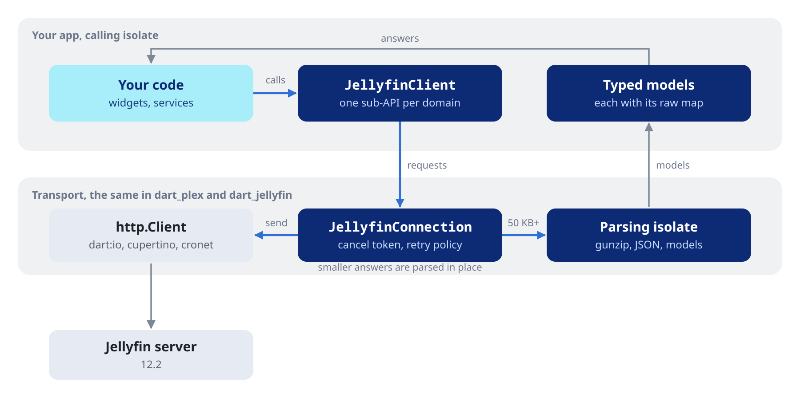

# dart_jellyfin

#### Jellyfin client for Flutter and Dart.

[](https://pub.dev/packages/dart_jellyfin)
[](https://api.jellyfin.org)
[](LICENSE)
[](https://github.com/ales-drnz/dart_jellyfin)
[](https://discord.gg/g2Qf4Mq9MP)
[](https://www.patreon.com/cw/ales_drnz)
[](https://www.buymeacoffee.com/ales.drnz)

<table>
<tr>
<td valign="middle" width="90"></td>
<td valign="middle"><code>dart_jellyfin</code> is a Dart client for Jellyfin 12.4, for servers from 12.0 on. It covers libraries, playlists, streaming, lyrics, playback reporting, remote control and search through typed Dart objects, and keeps the session for you.</td>
</tr>
</table>

---

## Features

<table>
<tr>
<td valign="middle" width="48"></td>
<td valign="middle" width="45%"><b>Pure Dart</b><br>no native plugin and no Flutter dependency. The main library also runs on the web; only <code>downloadToFile()</code> in <code>io.dart</code> needs <code>dart:io</code>.</td>
<td valign="middle" width="48"></td>
<td valign="middle" width="45%"><b>Typed models</b><br>every answer is a typed Dart object with a <code>raw</code> map, and item kinds, fields, sort keys and filters are <a href="https://pub.dev/documentation/dart_jellyfin/latest/topics/Library-topic.html">typed values</a>.</td>
</tr>
<tr>
<td valign="middle"></td>
<td valign="middle"><b>Both sign-in flows</b><br><a href="https://pub.dev/documentation/dart_jellyfin/latest/topics/Client%20and%20sign-in-topic.html">username and password</a>, and <a href="https://pub.dev/documentation/dart_jellyfin/latest/topics/Client%20and%20sign-in-topic.html">Quick Connect</a> with a code approved on another device.</td>
<td valign="middle"></td>
<td valign="middle"><b>Authorization header</b><br>the <code>MediaBrowser</code> header with client, device, version and token, rebuilt when the token changes (see <a href="https://pub.dev/documentation/dart_jellyfin/latest/topics/Client%20and%20sign-in-topic.html">Client and sign-in</a>).</td>
</tr>
<tr>
<td valign="middle"></td>
<td valign="middle"><b>One client</b><br>a <code>JellyfinClient</code> holds the identity, server, token and user, and every sub-API works through it.</td>
<td valign="middle"></td>
<td valign="middle"><b>Follows the OpenAPI document</b><br>routes, parameter names and casing match the contract at <a href="https://api.jellyfin.org">api.jellyfin.org</a>.</td>
</tr>
<tr>
<td valign="middle"></td>
<td valign="middle"><b>Lyrics with timing</b><br><a href="https://pub.dev/documentation/dart_jellyfin/latest/topics/Search%20and%20lyrics-topic.html"><code>JellyfinLyrics</code></a> with line and word timing, rendered to LRC or enhanced LRC with <code>toLrc()</code>.</td>
<td valign="middle"></td>
<td valign="middle"><b>Audio streaming</b><br><a href="https://pub.dev/documentation/dart_jellyfin/latest/topics/Audio%20streaming%20and%20HLS-topic.html">URL builders</a> for the server's choice between direct play and transcoding, the original file, a transcoded file and HLS.</td>
</tr>
<tr>
<td valign="middle"></td>
<td valign="middle"><b>Typed errors</b><br>every failure is a <a href="https://pub.dev/documentation/dart_jellyfin/latest/topics/Errors%20and%20paging-topic.html"><code>JellyfinException</code></a> with a type to branch on: auth, not found, timeout, connection, cancelled.</td>
<td valign="middle"></td>
<td valign="middle"><b>Escape hatch</b><br><a href="https://pub.dev/documentation/dart_jellyfin/latest/topics/Raw%20requests-topic.html"><code>request()</code>, <code>requestBytes()</code> and <code>requestStream()</code></a> for routes the sub-APIs do not cover.</td>
</tr>
<tr>
<td valign="middle"></td>
<td valign="middle"><b>Any HTTP stack</b><br>built on <code>package:http</code>: <a href="https://pub.dev/documentation/dart_jellyfin/latest/topics/Client%20and%20sign-in-topic.html">any <code>http.Client</code></a>, such as a <code>CupertinoClient</code> or <code>CronetClient</code> for HTTP/2 and the system proxy, or a <code>MockClient</code> in tests.</td>
<td valign="middle"></td>
<td valign="middle"><b>Off the caller's isolate</b><br>large answers are inflated, decoded and parsed on a background isolate, so the UI keeps its frames.</td>
</tr>
<tr>
<td valign="middle"></td>
<td valign="middle"><b>Cancellation and retries</b><br><a href="https://pub.dev/documentation/dart_jellyfin/latest/topics/Errors%20and%20paging-topic.html"><code>withCancelToken()</code></a> makes every call of a view cancellable, and a <a href="https://pub.dev/documentation/dart_jellyfin/latest/topics/Errors%20and%20paging-topic.html"><code>JellyfinRetryPolicy</code></a> resends idempotent requests after transient failures.</td>
<td valign="middle"></td>
<td valign="middle"><b>Streaming downloads</b><br><a href="https://pub.dev/documentation/dart_jellyfin/latest/topics/Events%20and%20downloads-topic.html"><code>downloadToFile()</code></a> writes a body to disk as it arrives, with progress, and never leaves a partial file.</td>
</tr>
</table>

---

## Getting started

```yaml
dependencies:
  dart_jellyfin: ^0.4.2
```

The package needs Dart 3.10 or later, and a Jellyfin server from 12.0 on.

### Stream a track

```dart
import 'package:dart_jellyfin/dart_jellyfin.dart';

Future<void> main() async {
  final jellyfin = JellyfinClient(
    baseUrl: 'https://jellyfin.example.com',
    credentials: const JellyfinCredentials(
      client: 'MyApp',
      device: 'iPhone',
      deviceId: 'PUT-YOUR-UUID-HERE', // stable per install
      version: '1.0.0',
    ),
  );

  // Sign in.
  final auth = await jellyfin.user.authenticateByName(
    username: 'me',
    password: 'hunter2',
  );
  jellyfin.setSession(token: auth.accessToken, userId: auth.user.id);

  // Find the music library and list its albums.
  final views = await jellyfin.library.userViews();
  final music = views.firstWhere((v) => v.isMusic);
  final albums = await jellyfin.items.list(
    parentId: music.id,
    includeItemTypes: const [JellyfinItemKind.musicAlbum],
    sortBy: const [JellyfinSortField.sortName],
    limit: 50,
  );

  // List the first album's tracks and build a stream URL for one.
  final tracks = await jellyfin.items.list(
    parentId: albums.items.first.id,
    includeItemTypes: const [JellyfinItemKind.audio],
  );
  final url = jellyfin.audio.universalStreamUrl(
    itemId: tracks.items.first.id,
    maxStreamingBitrate: 320000,
    audioCodec: 'aac',
    playSessionId: 'my-session-uuid',
  );
  print(url); // hand it to your audio engine

  // Release the HTTP client when the app is done with the server.
  jellyfin.close();
}
```

### How it works

`JellyfinClient` holds the identity of your app, the server, the token and the user. Each part of the Jellyfin API is a sub-API on it (`jellyfin.items`, `jellyfin.playlists`, `jellyfin.audio` and so on), and every call goes through one connection, the same transport `dart_plex` uses. Ids, names and keys are always named parameters.



---

## Working with the client

### Signing in with Quick Connect

```dart
final init = await jellyfin.quickConnect.initiate();
print('Enter ${init.code} in Jellyfin, under Settings, Quick Connect');

while (!(await jellyfin.quickConnect.state(secret: init.secret)).authenticated) {
  await Future<void>.delayed(const Duration(seconds: 2));
}

final auth = await jellyfin.user.authenticateWithQuickConnect(secret: init.secret);
jellyfin.setSession(token: auth.accessToken, userId: auth.user.id);
```

See [Client and sign-in](https://pub.dev/documentation/dart_jellyfin/latest/topics/Client%20and%20sign-in-topic.html) for the credentials, the session, the HTTP stack and the users.

### Browsing a library

```dart
final page = await jellyfin.items.list(
  parentId: music.id,
  includeItemTypes: const [JellyfinItemKind.musicAlbum],
  sortBy: const [JellyfinSortField.sortName],
  fields: JellyfinItemsApi.browseFields,
  limit: 50,
);
print('${page.items.length} of ${page.totalRecordCount}');
```

See [Library](https://pub.dev/documentation/dart_jellyfin/latest/topics/Library-topic.html) for the typed kinds, fields and filters, and for artists, genres, people and collections.

### Streaming and reporting a track

```dart
final url = jellyfin.audio.universalStreamUrl(
  itemId: track.id,
  maxStreamingBitrate: 320000,
  audioCodec: 'aac',
  playSessionId: 'my-uuid',
);
await jellyfin.playback.start(itemId: track.id, playSessionId: 'my-uuid');
```

See [Audio streaming and HLS](https://pub.dev/documentation/dart_jellyfin/latest/topics/Audio%20streaming%20and%20HLS-topic.html) for direct, transcoded and HLS URLs, and [Playback negotiation and reporting](https://pub.dev/documentation/dart_jellyfin/latest/topics/Playback%20negotiation%20and%20reporting-topic.html) for device profiles and the progress reports.

### A playlist

```dart
final playlist = await jellyfin.playlists.create(
  name: 'My Mix',
  mediaType: 'Audio',
  itemIds: const ['12345', '12346'],
);
await jellyfin.playlists.addItems(playlistId: playlist.id, itemIds: const ['99999']);
```

See [Playlists](https://pub.dev/documentation/dart_jellyfin/latest/topics/Playlists-topic.html) for entry ids, moving and removing entries, renames and sharing.

### Lyrics

```dart
final lyrics = await jellyfin.audio.lyrics(itemId: track.id);
if (lyrics != null && lyrics.isSynced) {
  print(lyrics.toLrc());
}
```

See [Search and lyrics](https://pub.dev/documentation/dart_jellyfin/latest/topics/Search%20and%20lyrics-topic.html) for word timing, uploads, remote lyrics, search and instant mixes.

### Covers

```dart
final url = jellyfin.images.url(
  itemId: track.artworkItemId ?? track.id,
  tag: track.artworkVersion,
  maxWidth: 512,
  maxHeight: 512,
);
```

See [User data and images](https://pub.dev/documentation/dart_jellyfin/latest/topics/User%20data%20and%20images-topic.html) for the sizing, the formats, favorites and display preferences.

### Errors and cancellation

```dart
final token = JellyfinCancelToken();
try {
  await jellyfin.withCancelToken(token).items.list(parentId: music.id);
} on JellyfinException catch (e) {
  if (e.isCancelled) return;
  if (e.isAuthError) await signInAgain();
}
```

See [Errors and paging](https://pub.dev/documentation/dart_jellyfin/latest/topics/Errors%20and%20paging-topic.html) for every error type, retries and paging.

### Events

```dart
final socket = await jellyfin.notifications.connect();
socket.events().listen((event) {
  if (event case JellyfinUserDataChangedEvent(:final changes)) {
    print('${changes.length} items changed');
  }
});
```

See [Events and downloads](https://pub.dev/documentation/dart_jellyfin/latest/topics/Events%20and%20downloads-topic.html) for every event and downloads to disk. [Raw requests](https://pub.dev/documentation/dart_jellyfin/latest/topics/Raw%20requests-topic.html) reach the routes the sub-APIs do not cover.

---

## Documentation

- [API reference](https://pub.dev/documentation/dart_jellyfin/latest/), with these guides:
  - [Client and sign-in](https://pub.dev/documentation/dart_jellyfin/latest/topics/Client%20and%20sign-in-topic.html): creating the client, credentials, the session, the HTTP stack, passwords, Quick Connect and users
  - [System](https://pub.dev/documentation/dart_jellyfin/latest/topics/System-topic.html): server info, counts, the clock, administration and localization
  - [Library](https://pub.dev/documentation/dart_jellyfin/latest/topics/Library-topic.html): libraries, items, typed kinds, fields and filters, artists, genres, people, facets, collections and channels
  - [Playlists](https://pub.dev/documentation/dart_jellyfin/latest/topics/Playlists-topic.html): creating, editing, reordering and sharing playlists
  - [Search and lyrics](https://pub.dev/documentation/dart_jellyfin/latest/topics/Search%20and%20lyrics-topic.html): search hints, suggestions, instant mixes and lyrics
  - [Audio streaming and HLS](https://pub.dev/documentation/dart_jellyfin/latest/topics/Audio%20streaming%20and%20HLS-topic.html): universal, direct and transcoded URLs, and the HLS playlists
  - [Playback negotiation and reporting](https://pub.dev/documentation/dart_jellyfin/latest/topics/Playback%20negotiation%20and%20reporting-topic.html): playback info, device profiles, live streams, the bitrate probe and play reports
  - [Sessions and SyncPlay](https://pub.dev/documentation/dart_jellyfin/latest/topics/Sessions%20and%20SyncPlay-topic.html): sessions, cast targets, remote control and SyncPlay groups
  - [User data and images](https://pub.dev/documentation/dart_jellyfin/latest/topics/User%20data%20and%20images-topic.html): favorites, played state, ratings, images and display preferences
  - [Video and subtitles](https://pub.dev/documentation/dart_jellyfin/latest/topics/Video%20and%20subtitles-topic.html): video URLs, direct play or transcoding, subtitles, trickplay and media segments
  - [TV, movies and live TV](https://pub.dev/documentation/dart_jellyfin/latest/topics/TV,%20movies%20and%20live%20TV-topic.html): seasons, episodes, next up, recommendations, trailers, channels, recordings and timers
  - [Errors and paging](https://pub.dev/documentation/dart_jellyfin/latest/topics/Errors%20and%20paging-topic.html): exceptions, classifying a failure, cancellation, retries and paging
  - [Events and downloads](https://pub.dev/documentation/dart_jellyfin/latest/topics/Events%20and%20downloads-topic.html): notifications, typed events and downloads to a file
  - [Raw requests](https://pub.dev/documentation/dart_jellyfin/latest/topics/Raw%20requests-topic.html): `request()`, `requestBytes()` and `requestStream()`
- [Example](example/)
- [CHANGELOG](CHANGELOG.md) and [MIGRATION](MIGRATION.md)

## Project background

I wrote the typed models, the sub-APIs and the transport with Claude Code.

Jellyfin is a trademark of the Jellyfin project. dart_jellyfin is not affiliated with it.

---

*Developed by Alessandro Di Ronza*
