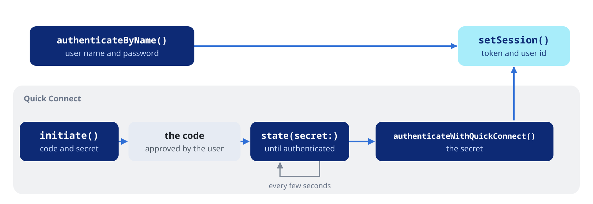

Create a client, give it your app's identity and a server, choose the HTTP stack, and sign in.

## Initialization and lifecycle


### Creating a client

```dart
final jellyfin = JellyfinClient(
  baseUrl: 'https://jellyfin.example.com',
  credentials: const JellyfinCredentials(
    client: 'MyApp',
    device: 'iPhone',
    deviceId: '2f5b-…-uuid',
    version: '1.0.0',
  ),
);
```

Only `credentials` is required. `baseUrl` can come later through
`connect()`. The other parameters:

| Parameter | Default | Description |
| :--- | :--- | :--- |
| `httpClient` | a `dart:io` or browser client | The `package:http` client to send through (see Choosing the HTTP stack below) |
| `connectTimeout` | 15 s | Bounds the handshake of the default client and, with `receiveTimeout`, the wait for the response headers |
| `receiveTimeout` | 30 s | Also bounds every pause inside a response body |
| `jsonIsolateThreshold` | 50 KB | Bodies this size or larger are decoded, and parsed into models, on a background isolate |
| `retryPolicy` | `JellyfinRetryPolicy.none` | Resends idempotent requests after a transient failure (see the [Errors and paging](https://pub.dev/documentation/dart_jellyfin/latest/topics/Errors%20and%20paging-topic.html) topic) |

With the default `dart:io` client, a gzip body is inflated as part of
that decode, so above the threshold it leaves the caller's isolate too.
The web has no isolates, and the work runs in place.

`JellyfinClient` and the sub-API classes are not `final`, so your tests
can implement or mock them. The models are `final` data classes.

### Credentials and the Authorization header

`JellyfinCredentials` says who the client is. Every request carries:

```
Authorization: MediaBrowser Client="MyApp", Device="iPhone", DeviceId="…uuid…", Version="1.0.0"
```

Once a session is set, the same header ends with `, Token="…"`. This is
the only authorization header the client sends, and the one Jellyfin 12
accepts by default.

`deviceId` must be a stable UUID for each installation: Jellyfin tracks
sessions and transcodes by it. Generate it once, store it
(SharedPreferences, Keychain, Android Keystore) and reuse it.

`JellyfinAuthHeader.build()` returns the header value, for a player that
sends its own requests:

```dart
final header = JellyfinAuthHeader.build(credentials, token: jellyfin.token);
```

### Server and session

```dart
jellyfin.connect('https://jellyfin.example.com'); // a trailing slash is dropped

jellyfin.setSession(token: savedToken, userId: savedUserId);
jellyfin.clearSession(); // drop the token and user id, keep the server
jellyfin.disconnect();   // drop the server too
```

`connect()` switches the client to another server and keeps the session:
call `clearSession()` first when the new server has other accounts.
`token`, `userId`, `baseUrl` and `isAuthenticated` are read-only getters,
so you can store the session and restore it with `setSession()`.

### Choosing the HTTP stack

The transport is `package:http`, so any `http.Client` works. On Apple
platforms and Android the native stacks bring HTTP/2, the system proxy
and the platform's certificate store:

```dart
// CupertinoClient.defaultSessionConfiguration() (package:cupertino_http),
// CronetClient.defaultCronetEngine() (package:cronet_http), or any other
// http.Client.
final http.Client httpClient = http.Client();

final jellyfin = JellyfinClient(
  baseUrl: 'https://jellyfin.example.com',
  credentials: credentials,
  httpClient: httpClient,
);

// Later: a client you pass in is yours to close.
httpClient.close();
```

In tests, pass a `MockClient` from `package:http/testing.dart`. A client
you pass in handles gzip itself; the native stacks do it on their own
threads.

### Closing the client

```dart
jellyfin.close();
```

`close()` closes the HTTP client the `JellyfinClient` created. Later
requests, through it or any `withCancelToken()` view, fail with
`JellyfinErrorType.state`. A client you passed as `httpClient` stays
open.

## Authentication



### Username and password

```dart
final auth = await jellyfin.user.authenticateByName(
  username: 'me',
  password: 'hunter2',
);
jellyfin.setSession(token: auth.accessToken, userId: auth.user.id);
```

`authenticateByName()` returns a `JellyfinAuthResult` with `accessToken`,
`serverId` and the `JellyfinUser`. Wrong credentials throw a
`JellyfinException` of type `auth`.

### Quick Connect

Quick Connect signs in a new device without a password: the user
approves a 6-character code on a device that is already signed in.

```dart
// Is Quick Connect on for this server?
if (!await jellyfin.quickConnect.enabled()) return;

// Start the flow on the new device and show the code.
final init = await jellyfin.quickConnect.initiate();
print('Enter ${init.code} in Jellyfin, under Settings, Quick Connect');

// Poll until the user approves it.
while (!(await jellyfin.quickConnect.state(secret: init.secret)).authenticated) {
  await Future<void>.delayed(const Duration(seconds: 2));
}

// Exchange the secret for a token.
final auth = await jellyfin.user.authenticateWithQuickConnect(secret: init.secret);
jellyfin.setSession(token: auth.accessToken, userId: auth.user.id);
```

To approve a code from the device that is already signed in:

```dart
await jellyfin.quickConnect.authorize(code: 'ABC123');
```

### Users

```dart
final me = await jellyfin.user.currentUser();
print('${me.name} (${me.id})');

// No token needed: the users the server shows on its sign-in screen.
final users = await jellyfin.user.publicUsers();
for (final u in users) {
  print('${u.name} (primaryImageTag=${u.primaryImageTag})');
}
```

With an admin token, `user` also manages accounts: `list()`, `byId()`,
`create()`, `updateProfile()`, `updatePolicy()`, `updateConfiguration()`,
`updatePassword()` and `delete()`. `forgotPassword()` and
`forgotPasswordPin()` run the password reset.
