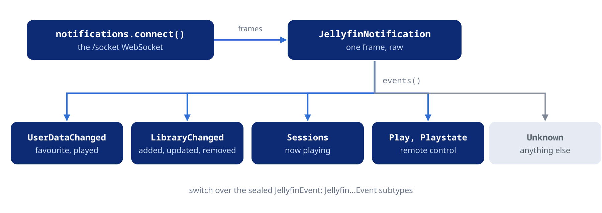

Follow the server's pushed events and download a file to disk.

## Notifications and typed events



The server pushes changes over a WebSocket: user data, library changes,
sessions, scheduled tasks and remote-control commands for this client.

### Connecting

```dart
final socket = await jellyfin.notifications.connect();

final subscription = socket.events().listen((event) {
  switch (event) {
    case JellyfinUserDataChangedEvent(:final changes):
      for (final c in changes) {
        print('${c.itemId} favorite=${c.isFavorite} played=${c.played}');
      }
    case JellyfinLibraryChangedEvent(:final itemsUpdated, :final itemsRemoved):
      print('re-read $itemsUpdated, drop $itemsRemoved');
    case JellyfinPlaystateEvent(:final command, :final seekPosition):
      print('remote asks: $command $seekPosition');
    case _:
  }
});

// Later:
await subscription.cancel();
await jellyfin.notifications.close();
```

`connect()` needs the server and the session, and returns a broadcast
stream of `JellyfinNotification` frames (`messageType`, `data`, `raw`).
`events()` on the stream, or `event` on one frame, decodes them into the
sealed `JellyfinEvent` type. Keep a `case _:` in a `switch` on it: a
release that types a new frame adds a subclass, and a `switch` without
one stops compiling. The client sends a keep-alive every
`keepAliveInterval` (30 seconds by default). Call `close()` before
connecting again: a `connect()` while a socket is open, or still
opening, throws a `state` error.

`connect()` waits for the handshake at most `connectTimeout` (15 seconds
by default) and then throws a `timeout` error. The stream ends when the
socket does, whoever closed it — the server, the network or `close()` —
and nothing reconnects it: call `connect()` again from the stream's
`onDone`. `JellyfinClient.close()` closes the socket too;
`clearSession()` and `disconnect()` leave it open.

### Typed events

| Event | `MessageType` | Holds |
| :--- | :--- | :--- |
| `JellyfinUserDataChangedEvent` | `UserDataChanged` | The user id and a `JellyfinUserDataChange` for each item (favorite, played, play count, position, last played); a track's change also carries its album |
| `JellyfinLibraryChangedEvent` | `LibraryChanged` | Items added, updated and removed, folders added to and removed from, sent in batches some seconds after the change |
| `JellyfinSessionsEvent` | `Sessions` | The `JellyfinSession` list, after `startSessions()` |
| `JellyfinPlayEvent`, `JellyfinPlaystateEvent`, `JellyfinGeneralCommandEvent` | `Play`, `Playstate`, `GeneralCommand` | Remote-control commands sent to this session |
| `JellyfinRefreshProgressEvent` | `RefreshProgress` | A library refresh's item id and progress |
| `JellyfinScheduledTasksInfoEvent`, `JellyfinScheduledTaskEndedEvent` | `ScheduledTasksInfo`, `ScheduledTaskEnded` | The `JellyfinScheduledTask` list after `startScheduledTasks()`, and a finished run |
| `JellyfinKeepAliveEvent` | `KeepAlive`, `ForceKeepAlive` | Keep-alive; `ForceKeepAlive` carries the server's timeout |
| `JellyfinSyncPlayCommandEvent` | `SyncPlayCommand` | The group's `Unpause`, `Pause`, `Stop` or `Seek`, with when to act and the position |
| `JellyfinSyncPlayGroupUpdateEvent` | `SyncPlayGroupUpdate` | The group update's type and data: the joined group, a user who joined or left, the new state |
| `JellyfinUserUpdatedEvent`, `JellyfinUserDeletedEvent` | `UserUpdated`, `UserDeleted` | The `JellyfinUser` after the change, or the deleted user's id |
| `JellyfinRestartRequiredEvent`, `JellyfinServerRestartingEvent`, `JellyfinServerShuttingDownEvent` | `RestartRequired`, `ServerRestarting`, `ServerShuttingDown` | Nothing: the server's state |
| `JellyfinTimerEvent` | `TimerCreated`, `TimerCancelled`, `SeriesTimerCreated`, `SeriesTimerCancelled` | The live TV timer's id and program id |
| `JellyfinPluginInstallationEvent`, `JellyfinPluginUninstalledEvent` | `PackageInstalling`, `PackageInstallationCompleted`, `PackageInstallationFailed`, `PackageInstallationCancelled`, `PackageUninstalled` | The plugin's id, name and version, or the removed `JellyfinPluginInfo` |
| `JellyfinActivityLogEvent` | `ActivityLogEntry` | New `JellyfinActivityLogEntry` items, after `startActivityLog()` |
| `JellyfinUnknownEvent` | Anything else | `messageType` and the whole frame in `raw` |

Decoding never throws: a frame whose `Data` has an unexpected shape
becomes a `JellyfinUnknownEvent` too. Remote-control commands reach the
socket of the session that owns the token, the device that signed in.

### Subscriptions

Sessions, scheduled tasks and the activity log are sent only on request:

```dart
jellyfin.notifications.startSessions(); // every 2 seconds by default
jellyfin.notifications.startScheduledTasks(interval: const Duration(seconds: 5)); // admin
jellyfin.notifications.startActivityLog(); // admin

socket.events().listen((event) {
  if (event case JellyfinSessionsEvent(:final sessions)) {
    print('${sessions.where((s) => s.isPlaying).length} playing');
  }
});

jellyfin.notifications.stopSessions();
jellyfin.notifications.stopScheduledTasks();
jellyfin.notifications.stopActivityLog();
```

`send(messageType:, data:)` sends any other message the server accepts.

## Downloads

### Downloading to a file

`downloadToFile()` is an extension in `package:dart_jellyfin/io.dart`,
kept out of the main library so that one stays usable on the web:

```dart
import 'package:dart_jellyfin/dart_jellyfin.dart';
import 'package:dart_jellyfin/io.dart';

Future<void> saveTrack(JellyfinClient jellyfin, JellyfinItem track) async {
  final token = JellyfinCancelToken();
  final (url, _) = jellyfin.audio.directStreamUrl(itemId: track.id);
  final written = await jellyfin.downloadToFile(
    url,
    '/music/${track.id}', // the original file, as stored on the server
    cancelToken: token,   // token.cancel() stops it and removes the file
    onProgress: (received, total) => print('$received / ${total ?? '?'}'),
  );
  print('$written bytes');
}
```

The body goes to `<path>.part` as it arrives, at the pace the disk
takes, and is renamed to the target only once complete. The target holds
either the whole file or what was there before: a failure, a stall past
`receiveTimeout` or a cancellation removes the partial file and throws a
`JellyfinException`. `onProgress` gets the total when the server sent a
`Content-Length`. For a smaller copy, download a
transcoded file URL. See the [Audio streaming and HLS](https://pub.dev/documentation/dart_jellyfin/latest/topics/Audio%20streaming%20and%20HLS-topic.html) topic.
