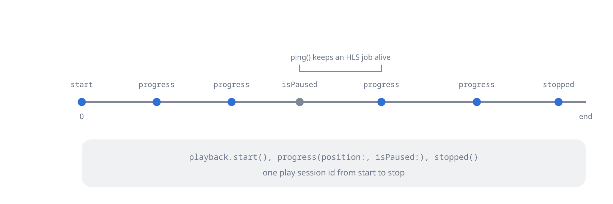

Ask the server how an item plays on this device, open live streams, and report what plays.

## Media info and playback negotiation

`/Items/{itemId}/PlaybackInfo` takes a `DeviceProfile`, what the client
can decode, and answers a `JellyfinPlaybackInfo` whose `mediaSources`
say whether each source plays directly (`supportsDirectPlay`,
`supportsDirectStream`, `supportsTranscoding`) and, when it does not,
carry a `transcodingUrl` to use as it is.

### Playback info

```dart
final info = await jellyfin.mediaInfo.info(itemId: track.id);
```

The `GET` form sends no device profile, so the server assumes generic
defaults. That suits audio; for video, post a profile.

### Posting a device profile

```dart
const profile = JellyfinDeviceProfile(
  name: 'MyApp',
  maxStreamingBitrate: 8000000,
  musicStreamingTranscodingBitrate: 320000,
  directPlayProfiles: [
    JellyfinDirectPlayProfile.audio(container: 'mp3,aac,flac'),
    JellyfinDirectPlayProfile.video(container: 'mp4,mkv,webm'),
  ],
);

final info = await jellyfin.mediaInfo.postedInfo(
  itemId: movie.id,
  deviceProfile: profile,
  maxStreamingBitrate: 8000000,
  subtitleStreamIndex: 3,
);
final source = info.mediaSources.first;
print('directPlay=${source.supportsDirectPlay} transcoding=${source.transcodingUrl}');
```

Each direct play profile names its media kind (`Audio` or `Video`), so an
audio source matches an audio profile. `transcodingProfiles`,
`codecProfiles`, `containerProfiles` and `subtitleProfiles` take the
finer rules as maps, and `extra` adds any other top-level field of the
profile.

### Live streams

A source with `RequiresOpening` in its `raw` map, such as a live TV
channel, needs an explicit open and close:

```dart
final opened = await jellyfin.mediaInfo.openLiveStream(
  openToken: source.raw['OpenToken'] as String,
  itemId: movie.id,
  deviceProfile: profile,
);
final liveStreamId = opened.mediaSources.first.raw['LiveStreamId'] as String;
// play, then:
await jellyfin.mediaInfo.closeLiveStream(liveStreamId: liveStreamId);
```

### Bitrate probe

The server sends `size` bytes; the time they take gives a starting
`maxStreamingBitrate`:

```dart
final stopwatch = Stopwatch()..start();
final size = await jellyfin.mediaInfo.bitrateTestBytesLength(size: 1000000);
stopwatch.stop();
final bitsPerSecond = (size ?? 0) * 8 * 1000 ~/ stopwatch.elapsedMilliseconds;
```

## Playback reporting



Reports tell the server what plays: they fill "Continue listening",
play counts and the dashboard, and keep a transcode alive. Positions are
`Duration`s; the library converts them to Jellyfin's ticks (100
nanoseconds).

### Start

```dart
await jellyfin.playback.start(
  itemId: track.id,
  playSessionId: 'my-uuid',
  mediaSourceId: track.mediaSources.first.id,
  method: JellyfinPlayMethod.transcode, // directPlay, directStream or transcode
);
```

### Progress

Send it about every 10 seconds and on every change of state:

```dart
await jellyfin.playback.progress(
  itemId: track.id,
  position: const Duration(seconds: 42),
  isPaused: false,
  volumeLevel: 80,
  playSessionId: 'my-uuid',
  method: JellyfinPlayMethod.transcode,
  order: JellyfinPlaybackOrder.shuffle, // or defaultOrder
  repeat: JellyfinRepeatMode.all,       // none, all or one
);
```

### Stopped

```dart
await jellyfin.playback.stopped(
  itemId: track.id,
  position: const Duration(seconds: 240),
  playSessionId: 'my-uuid',
);
```

`stopped()` ends the play session and its transcode.

### Ping

Tells the server the transcode of a play session is still wanted:

```dart
await jellyfin.playback.ping(playSessionId: 'my-uuid');
```

A player that sends `progress()` every 10 seconds needs no ping. Ping
covers stretches with nothing to report, such as buffering before the
first `start()`.
