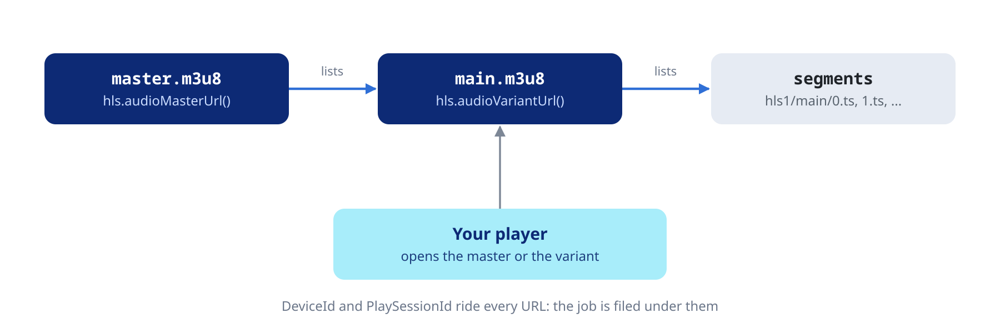

Build stream URLs for audio, direct or transcoded, and the HLS playlists for audio and video.

## Audio streaming

These methods build URLs and fetch nothing. Hand the URL to your audio
engine (mpv, AVPlayer, ExoPlayer). The token travels in the URL as
`ApiKey`, so segment requests need no extra headers.

### Universal stream URL

The server decides between direct play and transcoding from what the
client accepts:

```dart
final url = jellyfin.audio.universalStreamUrl(
  itemId: track.id,
  containers: const ['mp3', 'aac', 'flac', 'ogg', 'opus'],
  maxStreamingBitrate: 320000,
  audioCodec: 'aac',
  transcodingProtocol: 'hls', // or 'http'
  transcodingContainer: 'ts',
  playSessionId: 'my-uuid',
);
```

Other parameters: `mediaSourceId`, `audioBitRate`, `maxAudioChannels`,
`transcodingAudioChannels`, `maxAudioSampleRate`, `maxAudioBitDepth`,
`startTimeTicks`.

### Direct stream URL

The file as it is stored, with no transcoding:

```dart
final (url, ext) = jellyfin.audio.directStreamUrl(
  itemId: track.id,
  container: 'flac',
  playSessionId: 'my-uuid',
);
```

`isStatic` (on by default) serves the stored file. `ext` echoes
`container`, for naming a file.

### Transcoded file URL

A progressive transcode: one seekable file at a set bitrate, not HLS
segments. Use it to download a smaller copy:

```dart
final (url, ext) = jellyfin.audio.transcodedStreamUrl(
  itemId: track.id,
  audioCodec: 'aac',
  container: 'm4a',
  audioBitRate: 192000,
  playSessionId: 'download-${track.id}',
);
```

`audioBitRate` sets the bitrate, in bits per second. The container must
hold the codec. The server reuses a running transcode of the same item
for the same device and play session, whatever the other parameters
say, so give each download its own `playSessionId`.

## HLS playlists



Audio and video each have a `master.m3u8`, with every bandwidth variant,
and a `main.m3u8` with one. Use the master when the player picks the
quality, the variant when you already did.

The playlist URLs carry the token as `ApiKey` and, as `DeviceId`, the
device id of the credentials. The server files the transcode under that
device and `playSessionId`, and the playback reports (see the [Playback negotiation and reporting](https://pub.dev/documentation/dart_jellyfin/latest/topics/Playback%20negotiation%20and%20reporting-topic.html) topic)
reach it through the same pair.

### Audio master and variant

```dart
final masterUrl = jellyfin.hls.audioMasterUrl(
  itemId: track.id,
  maxStreamingBitrate: 320000,
  audioCodec: 'aac',
  playSessionId: 'my-uuid',
);
final mainUrl = jellyfin.hls.audioVariantUrl(
  itemId: track.id,
  audioCodec: 'aac',
  audioBitRate: 256000,
  segmentContainer: 'mp4', // 'ts' or 'mp4'
  segmentLength: 6,        // seconds
  minSegments: 1,          // segments ready before the server answers
  enableAutoStreamCopy: false, // both false: always transcode
  allowAudioStreamCopy: false,
  playSessionId: 'my-uuid',
);
```

Also typed: `audioSampleRate`, `maxAudioBitDepth`, `audioChannels`,
`maxAudioChannels`, `startTimeTicks`, `breakOnNonKeyFrames` and `context`
(`Streaming` or `Static`). `params` adds any other query parameter as it
is.

### Video master and variant

```dart
final masterUrl = jellyfin.hls.videoMasterUrl(
  itemId: movie.id,
  videoCodec: 'h264',
  audioCodec: 'aac',
  videoBitRate: 8000000,
  audioBitRate: 192000,
  maxWidth: 1920,
  maxHeight: 1080,
  subtitleStreamIndex: 3,
  subtitleMethod: 'Hls',
);
```

`videoVariantUrl()` takes the same parameters. Cap a video transcode
with `videoBitRate` and `audioBitRate`: the video routes do not read
`maxStreamingBitrate`.

### Segments, live and stopping a transcode

The player walks the playlist, so segment URLs are rarely needed. They
are there for cache warming or debugging:

```dart
final segmentUrl = jellyfin.hls.videoSegmentUrl(
  itemId: movie.id,
  playlistId: 'main',
  segmentId: 0,
  container: 'ts',
);
```

For a live TV channel the server keeps the playlist growing. Use the live
variant:

```dart
final liveUrl = jellyfin.hls.videoLiveUrl(
  itemId: channelId,
  videoCodec: 'h264',
  audioCodec: 'aac',
);
```

`playback.stopped()` (see the [Playback negotiation and reporting](https://pub.dev/documentation/dart_jellyfin/latest/topics/Playback%20negotiation%20and%20reporting-topic.html) topic) ends a transcode.
